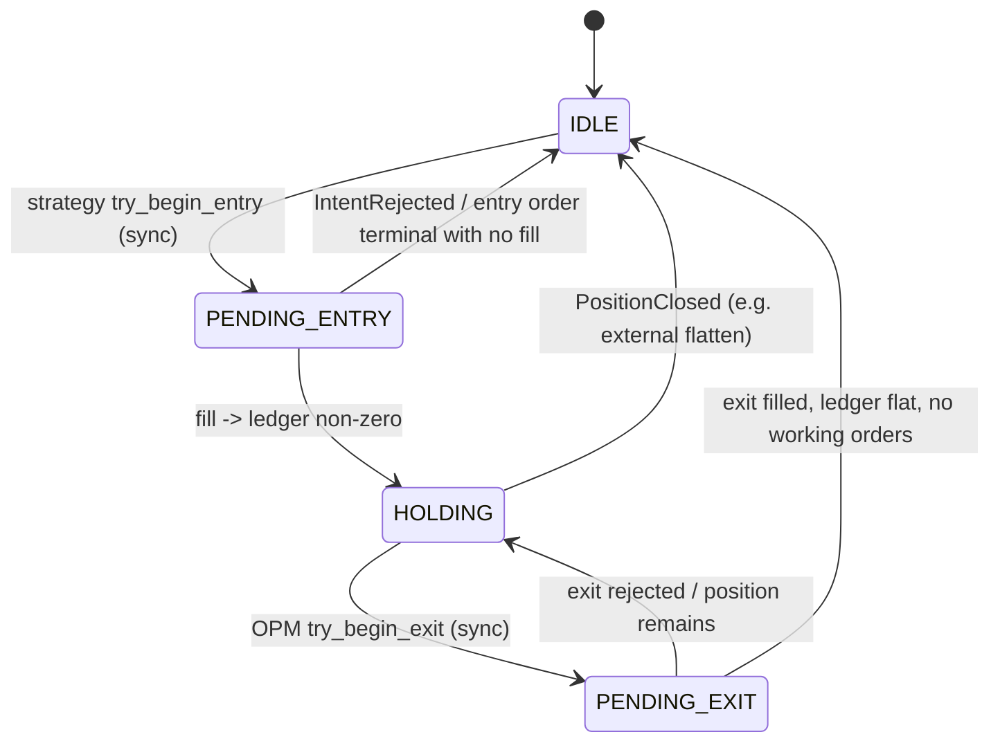
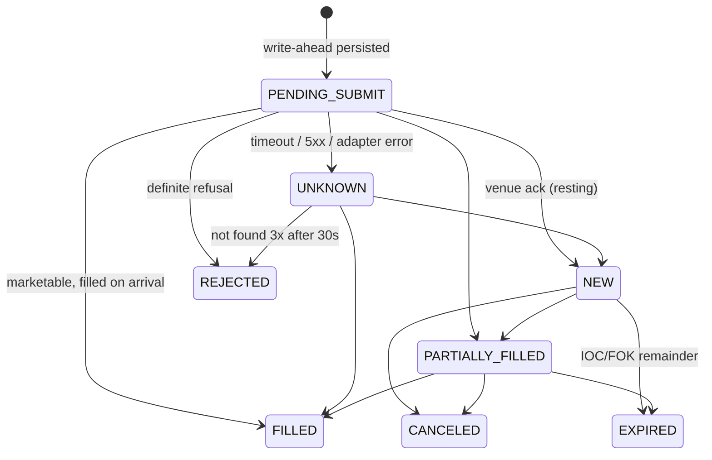
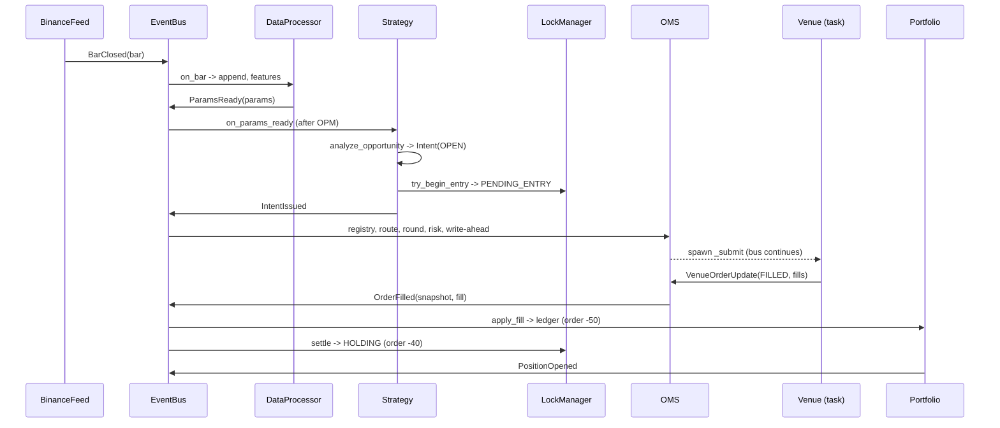

# Trading System Skeleton — Architecture & Reconstruction Manual

Oct 5, 2026 · @Jerry — **v2, revised Oct 10, 2026** to describe the implemented MVP

This document plus the class docstrings in the code are the complete description of the system. Read it top to bottom and you can rebuild every package: what each box is, which types flow between the boxes, the order things happen in, which component owns which piece of state, and why each trade-off was made. The v1 design (the architecture diagram in `Design Document.pdf` and the original skeleton) is still the soul of the project; where the implementation departed from it, the departure and its reason are written down here (§3, §15).

**How to read it.** §1–§3 give the shape and the rules. §4–§6 cover the moving parts: events, state machines and timelines. §7 is the per-package class reference, at the level of a Java class diagram. §8–§11 cover persistence, concurrency, the simulator and configuration. §12–§15 cover testing, how-to recipes, what is still planned, and what changed from v1.

---

## 1. The map

Boxes from the architecture diagram are packages. The arrows between boxes are the shared types in `messages/`. `main.py` is the pair of hands that plugs the boxes together.

```text
trading_infrastructure/
├── main.py                        # composition root: builds, wires, starts, shuts down
├── requirements.txt               # pinned: aiohttp, aiosqlite, websockets, python-dotenv
├── .env                           # secrets only (never committed)
│
├── config/
│   └── settings.py                # every tunable + strategy registry + validate()
│
├── messages/                      # THE ARROWS — imported by everyone, imports nothing
│   ├── model.py                   #   nouns: Bar, MarketParams, Intent, OrderRequest, Fill,
│   │                              #          OrderSnapshot, VenueOrderUpdate, Position, enums
│   ├── events.py                  #   verbs: BarClosed, ParamsReady, IntentIssued/Rejected,
│   │                              #          Order* lifecycle, Position*, RiskBreach, ...
│   └── instruments.py             #   InstrumentSpec + InstrumentRegistry (tick/lot rounding, filters)
│
├── bus/
│   └── event_bus.py               # GREEN: Central Event Bus (Mediator, priority + FIFO)
│
├── data/                          # GREEN: Data Processing
│   ├── processor.py               #   DataProcessor + RollingWindow: owns all market state
│   └── warmup.py                  #   WarmupLoader: gap healing + window rehydration at startup
│
├── strategies/                    # GREEN: Strategy
│   ├── base.py                    #   BaseStrategy (template: replay guard + lock + publish)
│   └── mock_strat.py              #   MockStrat (soak test)
│
├── opm/                           # GREEN: Open Position Manager
│   ├── lock.py                    #   LockManager: the PositionLock state machine
│   └── manager.py                 #   OpenPositionManager: exit decisions
│
├── risk/                          # GREEN: Risk Manager
│   └── pretrade.py                #   RiskRule chain + PreTradeRiskManager
│
├── execution/                     # GREEN: OMS
│   ├── oms.py                     #   OrderManagementSystem + Order aggregate
│   ├── order_ids.py               #   client order id generation
│   └── router.py                  #   VenueRouter: ExecutionMode -> venue
│
├── connectors/                    # BLUE: Brokerage Connectors (both edges)
│   ├── base.py                    #   THE PORTS: ExecutionVenue, MarketDataFeed, HistoricalBarSource
│   ├── binance/
│   │   ├── codec.py               #     all Binance JSON <-> canonical types
│   │   ├── rest.py                #     public REST: klines (backfill), exchangeInfo
│   │   ├── feed.py                #     kline websocket -> BarClosed
│   │   ├── quotes.py              #     bookTicker + aggTrade websocket -> simulator
│   │   └── venue.py               #     signed order REST (TESTNET / LIVE)
│   └── sim/
│       └── venue.py               #     SimulatedVenue: matching engine on live mainnet quotes
│
├── state/                         # BLUE: Persistent State
│   ├── schema.sql                 #   tables (schema v2, epoch-ms timestamps)
│   ├── stores.py                  #   SqliteStore: single-writer repository
│   └── portfolio.py               #   PortfolioManager: per-strategy ledgers (single writer)
│
├── ops/                           # BLUE: support services
│   └── journal.py                 #   DatabaseJournal: audit trail
│
├── tools/
│   └── audit_db.py                # offline DB inspection / kline continuity audit
└── tests/                         # unittest suite (no network): python -m unittest discover -s tests -t .
```

| Box in the diagram | Package | Load-bearing pattern | Status |
|---|---|---|---|
| Brokerage Connectors (in) | `connectors/binance` feed, rest, quotes | Adapter | ✅ |
| Central Event Bus | `bus/` | Mediator | ✅ |
| Data Processing | `data/` | Facade | ✅ (placeholder features) |
| Strategy | `strategies/` | Strategy + Template Method | ✅ (mock strategy) |
| Open Position Manager | `opm/` | State (lock) + Strategy (exits) | ✅ lock / ⚠ exit engines are placeholders |
| Risk Manager | `risk/` | Chain of Responsibility | ✅ pre-trade / ⏳ allocator, supervisor |
| OMS | `execution/` | State (order lifecycle) + Command | ✅ |
| Brokerage Connectors (out) | `connectors/binance/venue`, `connectors/sim` | Adapter behind a Port | ✅ |
| Persistent State / SQLite | `state/` | Repository | ✅ |
| Telegram Communicator | `ops/` | plain services | ⏳ (journal only) |
| The arrows | `messages/` | immutable dataclasses | ✅ |
| The hands | `main.py` | Composition root / DI | ✅ |

---

## 2. The rules

### Structural rules (unchanged from v1)

1. **Boxes are packages, arrows are `messages/`.** Anything that flows *between* boxes lives in `messages/`, which imports nothing from the project. If a type is used by two boxes it belongs there.
2. **Imports point inward.** Adapters (`connectors/`, `state/`, `ops/`) import `messages/` and the ports in `connectors/base.py`. The green core never imports a concrete adapter; only `main.py` does. The word "Binance" never appears in `strategies/`, `opm/`, `risk/` or `execution/`.
3. **One facade per box.** Each package exposes one class whose surface is its bus subscriptions plus a narrow API (`DataProcessor`, `OpenPositionManager`, `OrderManagementSystem`, …). Helpers stay private to the package.
4. **Construction happens in exactly one place.** Every dependency arrives through `__init__`, and only `main.py` (and the test fixture) calls constructors. This is what lets the tests run every box against fakes.

### Runtime invariants (new in v2; every bug fixed in the review traces back to one of these being violated)

5. **Single writer per piece of state.** Order state belongs to the OMS. Positions belong to the PortfolioManager. Market state belongs to the DataProcessor. Lock state belongs to the LockManager. Each database file has one SQLite write connection. Venues never mutate core state and never publish on the bus.
6. **Everything on the bus is frozen, all the way down.** Events carry `OrderSnapshot` and `Position` snapshots, never live objects, so a subscriber can never observe state from the future.
7. **Every command ends in exactly one terminal outcome.** An `IntentIssued` becomes either an order (an `Order*` event stream) or an `IntentRejected`, never both and never neither. Silent drops used to leave the lock stuck forever.
8. **No network I/O on the bus loop.** Handlers do in-memory work plus at most a local SQLite commit. Venue calls run as background tasks.
9. **Unknown is not rejected.** A timed-out order stays UNKNOWN and keeps the lock engaged until it has been reconciled against the venue. Treating a timeout as a failure is how strategies double-enter.
10. **Never trade on history.** Backfilled bars carry `replay=True`. They update market state, but strategies and the OPM refuse to act on them.
11. **Locks are acquired synchronously at the moment of decision.** `try_begin_entry` / `try_begin_exit` are check-and-set calls with no `await` in between, so exactly one decision can win.

---

## 3. Key decisions and trade-offs

| Decision | Why | Cost / revisit when |
|---|---|---|
| Market data always from **mainnet** | Testnet data is useless for features | — |
| Paper trading = **internal simulator** on live mainnet quotes (`ExecutionMode.SIM`), not the Binance testnet | The testnet book is thin and unrelated to mainnet, so paper PnL would measure the testnet rather than the strategy | The simulator is a model; calibrate it against small live fills |
| Testnet kept as `ExecutionMode.TESTNET` | API integration checks (signing, filters, order types) | — |
| Routing is per strategy (`STRATEGY_REGISTRY`) | Promotion path SIM → small LIVE → full LIVE | Ledgers/reconciliation must stay per mode |
| Binance fills by **polling** (`query` + `myTrades`) | Simple and robust on both testnet and live | Add a user-data stream when latency matters |
| Quote stream **bypasses the bus** | bookTicker/aggTrade run at hundreds of msgs/s per symbol; the bus is the critical path | — |
| Floats in the domain, **Decimal at the exchange boundary** | Simplicity; rounding is where float error bites | Move ledgers to Decimal/int ticks before real size |
| Spot semantics (no shorting) | The venue is Binance Spot | Futures needs a new venue and margin model |
| Placeholder features/exits use RNG | MVP plumbing soak test | Replace with `data/features.py` and `opm/engines.py` |

---

## 4. The event bus and the event catalogue

### Ordering
The bus is a single `asyncio.PriorityQueue` of `(priority, seq, event)`. `seq` is assigned at **publish** time, so:
- lower priority value first (CRITICAL 0 > HIGH 1 > NORMAL 2 > LOW 3);
- within a priority, strict FIFO, which is deterministic and replayable;
- `Event.timestamp` is informational only and never used for ordering.

**Causality rule:** every event about a live order or position is HIGH. A fill can therefore never overtake its own accept, and a `PositionClosed` can never overtake the fill that caused it. The priority lanes give urgency only *between* different kinds of work: exits and fills before new bars.

### Handler order (`subscribe(..., order=)`; lower runs first, then subscription order)

| order | Handler | Why it is there |
|---|---|---|
| −200 | `DatabaseJournal.log_intent` | the intent row must exist before the OMS resolves it |
| −100 | `LockManager` (intent audit, `IntentRejected`, `Position*`) | the lock observes outcomes first |
| −50 | `PortfolioManager.on_fill_event` | the ledger is updated before anyone reads positions |
| −40 | `LockManager._on_order_event` | settles **after** the ledger shows the fill, so there is no transient IDLE |
| −20 | `store.save_bar` (lambda in main) | persist the raw bar |
| −15 | `sim_venue.on_bar` (lambda in main) | simulator degraded mode |
| −10 | `OpenPositionManager.on_params_ready` | **exits outrank entries** on every bar |
| 0 | strategies, OMS, DataProcessor, everything else | default |
| 100 | `print_telemetry` | log last |

Handlers are resolved over the event's class hierarchy (MRO), so subscribing to `OrderEvent` or `Event` receives every subclass.

### Event catalogue

| Event | Payload | Publisher | Consumers | Priority |
|---|---|---|---|---|
| `BarClosed` | `bar: Bar`, `replay` | BinanceFeed | DataProcessor, store, SimulatedVenue | NORMAL |
| `ParamsReady` | `params: MarketParams`, `replay` | DataProcessor | OPM (−10), strategies (0), telemetry (100) | NORMAL |
| `IntentIssued` | `intent: Intent` | strategies (OPEN), OPM (CLOSE) | Journal, Lock (audit), OMS | NORMAL / HIGH for exits |
| `IntentRejected` | `intent, stage: RejectStage, rule_name, reason` | OMS | Lock, Journal | HIGH |
| `CancelIssued` | `intent: CancelIntent` | any decision maker | OMS | HIGH |
| `OrderAccepted` | `order: OrderSnapshot` | OMS | Lock | HIGH |
| `OrderPartiallyFilled` / `OrderFilled` | `order`, `fill: Fill` | OMS | Portfolio, Lock | HIGH |
| `OrderCanceled` / `OrderExpired` / `OrderRejected` | `order`, `reason` | OMS | Lock | HIGH |
| `OrderStatusUnknown` | `order`, `reason` | OMS | Lock (stays pending) | HIGH |
| `PositionOpened` / `PositionChanged` / `PositionClosed` | `position: Position` (+ delta / realized PnL) | PortfolioManager | Lock, OPM | HIGH |
| `RiskBreach` | `rule_name, symbol, detail` | OMS (vanished order) | Journal | CRITICAL |
| `SignalGenerated`, `ResizeRequest`, `KillSwitch`, `Heartbeat` | — | *planned* | — | — |

---

## 5. State machines

### PositionLock — one per `(strategy_id, symbol)` (`opm/lock.py`)



- **Who may act:** IDLE = the strategy may enter. HOLDING = the OPM may exit. PENDING_* = nobody may act.
- **Settling** happens only on terminal facts. The resting state is then *derived*: a position exists → HOLDING; working orders remain → PENDING_ENTRY; otherwise → IDLE. Position truth comes from `PortfolioManager.get_position` (rule 5).
- **`OrderStatusUnknown` never settles**, so the strategy cannot double-enter while an order's fate is unknown.

### Order lifecycle — owned by the OMS (`messages/model.OrderStatus`, `execution/oms._apply_update`)



How the OMS decides the effective status on each venue update:
- The venue wins, **unless fills are missing**. If the venue says FILLED, CANCELED or EXPIRED while the venue's cumulative quantity is greater than the fills received so far, the order stays working (PARTIALLY_FILLED or NEW) until the fills arrive on a later poll.
- A known state is never downgraded to UNKNOWN.
- Fills summing to the full quantity force FILLED.
- Terminal states never change again.

---

## 6. Runtime sequences

### 6.1 Startup (`main.main`)
1. `settings.validate()`: fail loudly if a LIVE or TESTNET strategy lacks keys.
2. `SqliteStore.start()`: create or verify schema v2 (WAL) and launch the writer task.
3. `load_instruments()`: mainnet `exchangeInfo` → `InstrumentRegistry` (falls back to `default_spec`).
4. Build the venues (`SimulatedVenue` always; `BinanceVenue` per TESTNET/LIVE mode in use) and the `VenueRouter`.
5. Build the core: `DatabaseJournal`, `PortfolioManager`, `LockManager(position_view=portfolio.get_position)`, `DataProcessor`, `OpenPositionManager`, `PreTradeRiskManager(rules)`, `OrderManagementSystem`, strategies. Abort if any strategy id is missing from `STRATEGY_REGISTRY`.
6. Subscribe the glue: `save_bar`, `sim.on_bar`, telemetry.
7. `WarmupLoader.heal_gaps()`: REST-fill internal and trailing gaps over the last `MAX_BACKFILL_HOURS`, then `flush()`. Then `warm()`: load `MAX_LOOKBACK` bars into each window.
8. Start the venues and the OMS poller, then create tasks for `bus.run()`, `feed.start()` and `quotes.start()`.
9. Wait for a stop signal or for any core task to die.

### 6.2 Entry → fill → position (the happy path)



### 6.3 Exit
On a live `ParamsReady`, the OPM (order −10) runs before any strategy. It finds the positions on that symbol whose lock is HOLDING and evaluates them. If it decides to exit, it calls `try_begin_exit` (→ PENDING_EXIT) and publishes `IntentIssued(CLOSE, MARKET, |qty|, priority=HIGH)`.

In the OMS, a CLOSE intent:
- must have a position to reduce (rejected with rule `ReduceOnly` otherwise);
- is clamped to the position size;
- cancels the strategy's resting entry orders;
- runs only the risk rules with `applies_to_exits=True`.

When the fill arrives, the portfolio sees the ledger go flat and publishes `PositionClosed` with PnL net of fees. The lock settles to IDLE.

### 6.4 Rejection anywhere
Registry, routing, validation, risk or an exception → `IntentRejected(stage)` → the lock settles (back to IDLE for entries, back to HOLDING for exits) and the journal writes a `risk_ledger` row. A venue refusal produces `OrderRejected` with the same effect on the lock.

### 6.5 Timeout (unknown outcome)
`venue.submit` raises `VenueUnknownOutcome` → `OrderStatusUnknown` → the lock **stays** pending. Every `poll_interval` (3 s), the OMS queries the venue by client order id:
- **found:** apply the real state (e.g. FILLED → position → HOLDING);
- **"not found" 3 times and the order is older than `unknown_resolution_seconds` (30 s):** REJECTED, and the lock releases;
- **a working NEW order goes missing:** `RiskBreach("OrderVanished")`.

### 6.6 Websocket reconnect
`BinanceFeed` reconnects with backoff, then `_backfill_gaps()` fetches **closed** bars after the last published start time and publishes them with `replay=True`. They warm the windows; strategies and the OPM ignore them. Duplicates are dropped by both the feed (`_last_start_ms`) and `RollingWindow.append`.

### 6.7 Shutdown (`main.shutdown`; runs on SIGINT/SIGTERM and on Windows Ctrl+C, which cancels the main task)
1. Stop the feed and the quote stream.
2. `oms.stop()`: cancel the poller and wait up to 10 s for in-flight venue calls.
3. `bus.drain()` (up to 10 s), then `bus.stop()` (the sentinel), then wait for the bus task.
4. Cancel the remaining tasks, stop the venues, close the REST session.
5. **Always** `store.stop()`, which flushes the write queue.

Resting orders at the venue are deliberately left untouched.

---

## 7. Package reference (class diagrams)

Notation: `+` public, `-` private, `«sub»` bus subscription, `«pub»` publication. The code docstrings repeat these blocks next to the implementation.

### 7.1 `messages/` — the arrows

```text
enum ExecutionMode   SIM | TESTNET | LIVE                      (router key; per-strategy in settings)
enum OrderSide       BUY | SELL              + opposite, + sign (+1/-1)
enum OrderType       MARKET | LIMIT | STOP_LOSS | STOP_LOSS_LIMIT | TAKE_PROFIT | TAKE_PROFIT_LIMIT
                     LIMIT_PRICED_TYPES need price; STOP_TYPES need stop_price
enum TimeInForce     GTC | IOC | FOK
enum OrderStatus     PENDING_SUBMIT | NEW | PARTIALLY_FILLED | FILLED | CANCELED | REJECTED | EXPIRED | UNKNOWN
                     + is_terminal  (FILLED, CANCELED, REJECTED, EXPIRED)
enum IntentKind      OPEN | CLOSE | SCALE_IN | SCALE_OUT | FLATTEN   + is_entry, + is_exit
enum RejectStage     REGISTRY | ROUTING | VALIDATION | RISK | EXCEPTION
enum ManagementAction HOLD | CLOSE | MOVE_STOP | RESIZE        (planned)

frozen Bar             symbol, venue, interval, start_time, close_time, open, high, low, close, volume, is_closed
                       identity = (symbol, interval, start_time)
frozen MarketParams    symbol, latest_bar: Bar, features: Mapping[str,float] (read-only), volatility_estimate
frozen Signal          strategy_id, symbol, side, probability, features_snapshot, model_version, signal_id   (planned)
frozen Intent          strategy_id, symbol, venue, kind, side, order_type, quantity, price?, stop_price?,
                       time_in_force, reason, intent_id (correlation id), signal_id?, created_at
frozen CancelIntent    strategy_id, symbol, client_order_id, reason
frozen OrderRequest    client_order_id, symbol, venue, side, order_type, quantity, price?, stop_price?, time_in_force
                       (rounded; the ONLY thing a venue receives)
frozen Fill            client_order_id, strategy_id, intent_id, symbol, side, quantity (>0 delta), price,
                       fee, fee_asset, is_maker, exchange_trade_id (dedupe key), timestamp
frozen OrderSnapshot   client_order_id, strategy_id, mode, intent, request, status, filled_quantity,
                       average_price, cumulative_fee, venue_order_id?, version, created_at, updated_at
                       + remaining_quantity
frozen VenueOrderUpdate client_order_id, status, venue_order_id?, fills: tuple[Fill], cumulative_filled_quantity?,
                       reason, timestamp            (port return type; fills may repeat)
frozen Position        strategy_id, symbol, venue, mode, quantity (SIGNED), average_entry_price,
                       realized_pnl (net of fees), fees_paid, protective_order_id?, opened_at, updated_at
                       + side (derived), + is_flat
frozen PositionView    quantity, average_entry_price, bars_held      (planned, for Strategy.manage)
+ utc_now() -> aware UTC datetime        + new_id() -> uuid4 hex
```

```text
class InstrumentSpec (frozen)     symbol, venue, base_asset, quote_asset, tick_size, step_size,
                                  min_qty, max_qty, min_notional, market_step_size?   (Decimals)
class InstrumentRegistry
  - _specs: Dict[str, InstrumentSpec]
  + add(spec) / get(sym) / require(sym) / symbols() / __contains__
  + round_qty(sym, qty, market=False) -> float       DOWN to step
  + snap_qty(sym, qty) -> float                      nearest step (float-drift cleanup)
  + round_price(sym, px, side_sign=0) -> float       BUY down, SELL up, 0 nearest
  + is_qty_dust(sym, qty) -> bool                    |qty| < step
  + format_qty / format_price(sym, x) -> str         plain decimal wire strings
  + validate(sym, qty, px?, market=False) -> str?    "Filter failure: LOT_SIZE|PRICE_FILTER|NOTIONAL"
+ default_spec(symbol) -> InstrumentSpec             fallback when exchangeInfo is unavailable
```

`messages/events.py`: `Event(timestamp, event_id, priority)` and the subclasses in §4. `OrderEvent(order)` is the base of all `Order*` events.

### 7.2 `bus/event_bus.py`

```text
class EventBus
  - _subscribers: Dict[type, List[_Subscription(order, seq, handler)]]
  - _resolved: Dict[type, tuple[handler]]          MRO-merged, sorted cache
  - _queue: PriorityQueue[(priority, seq, Event|None)]
  + subscribe(event_type, handler, *, order=0)
  + publish(event) (async) / publish_nowait(event)  enqueue only
  + run()          drain loop; exits on the stop sentinel or cancellation
  + drain()        await queue.join() (includes cascades)
  + stop()         enqueue the sentinel (sorts after everything)
  + depth          queue length
```

### 7.3 `connectors/` — ports and adapters

```text
«port» ExecutionVenue            venue_id, mode, needs_polling
  + start() / stop() / set_update_handler(async cb(VenueOrderUpdate))
  + submit(OrderRequest) -> VenueOrderUpdate        raises VenueUnknownOutcome if unsure
  + cancel(symbol, coid) -> VenueOrderUpdate | None  None = unknown order
  + query(symbol, coid)  -> VenueOrderUpdate | None  None = does not exist
«port» MarketDataFeed            + start() / stop()
«port» HistoricalBarSource       + fetch_bars(symbol, interval, start_ms, end_ms?) -> [Bar]
exception VenueUnknownOutcome
```

```text
binance/codec.py   (functions; ALL Binance JSON lives here)
  + interval_ms("1m") -> 60000
  + bar_from_rest_kline(sym, interval, k) / bar_from_ws_kline(k) -> Bar
  + spec_from_symbol_info(info) -> InstrumentSpec      PRICE_FILTER, LOT_SIZE, MARKET_LOT_SIZE, NOTIONAL
  + STATUS_MAP  Binance status -> OrderStatus           (EXPIRED_IN_MATCH -> EXPIRED, PENDING_CANCEL -> working)
  + update_from_order_response(data, side) -> VenueOrderUpdate
  + fills_from_my_trades(trades, coid) -> tuple[Fill]
  + error_message(data) -> "[code] msg"

class BinanceMarketDataREST          «HistoricalBarSource»; public mainnet; one session, 10s timeout
  + fetch_bars(...)                  paginated x1000, drops any kline whose close_time is in the future
  + fetch_instrument_specs(symbols)  GET /api/v3/exchangeInfo?symbols=[...]

class BinanceFeed                    «MarketDataFeed»   «pub» BarClosed
  - _last_start_ms: Dict[sym, int]   dedupe + backfill cursor
  + start()  loop: connect combined kline stream -> _backfill_gaps() (replay=True) -> read closed klines
  + stop()

class BinanceQuoteStream             bookTicker (+aggTrade) -> QuoteSink callbacks (NOT the bus)
«protocol» QuoteSink                 on_book_ticker(sym, bid, bid_qty, ask, ask_qty), on_trade(sym, px, qty, is_buyer_maker)

class BinanceVenue                   «ExecutionVenue» mode TESTNET|LIVE, needs_polling=True
  - _session, current_weight, _backoff_until
  + submit / cancel / query          see class docstring for the outcome classification
  - _guard()  refuse (not send) under back-off or weight budget
  - _signed(method, path, params)    HMAC-SHA256, recvWindow, timestamp
```

```text
class SimulatedVenue                 «ExecutionVenue» mode SIM, needs_polling=False   (see §10)
  + on_book_ticker / on_trade / on_bar     market-data inputs (sync)
  + submit / cancel / query                port (async, simulated latency)
  + balances() -> {asset: {free, locked}}
  - _accept, _walk, _execute_market, _execute_limit, _match_on_book, _match_on_trade,
    _match_on_bar, _trigger_stops, _lock, _release, _settle, _close, _emit, _dispatch_loop
class SimConfig                      all knobs (balances, fees, latency, staleness, depth model, rate limit, seed)
```

### 7.4 `data/`

```text
class RollingWindow(maxlen)          bars/closes/volumes deques
  + append(bar) -> bool              False unless strictly newer (dedupe)
  + is_warmed_up                     len == maxlen
class DataProcessor                  «sub» BarClosed   «pub» ParamsReady
  - _windows: Dict[sym, RollingWindow]     only active_assets
  - _latest_params: Dict[sym, MarketParams]
  + on_bar(e)                        append -> warm-up guard -> features (to_thread) -> cache -> publish
  + warm_up(sym, bars) / window_status(sym)
  + get_latest_market_state(sym) -> dict   {close, volume, bar_close_time, volatility_estimate, *features}
class WarmupLoader(store, source, interval, recovery_hours)
  + heal_gaps(symbols)               internal + trailing gaps -> store -> flush
  + warm(processor, symbols)         newest max_lookback bars -> processor
```

### 7.5 `strategies/`

```text
abstract class BaseStrategy(bus, lock_manager, strategy_id, symbols)   «sub» ParamsReady(order 0)  «pub» IntentIssued
  + on_params_ready(e)   own symbol -> not replay -> lock IDLE -> analyze -> try_begin_entry -> publish
  # analyze_opportunity(params) -> Intent | None      ← the only thing a strategy implements
class MockStrat          5%/bar random-side MARKET 0.01
```

### 7.6 `opm/`

```text
enum LockState  IDLE | PENDING_ENTRY | HOLDING | PENDING_EXIT
class LockManager(bus, position_view?)
  - _slots: Dict[(sid, sym), _Slot(state, pending_intent_id, working:set, has_position)]
  + state / can_strategy_enter / can_opm_manage
  + try_begin_entry(intent) -> bool / try_begin_exit(intent) -> bool      synchronous CAS
  «sub» IntentIssued(audit), IntentRejected, OrderEvent(-40), PositionOpened, PositionClosed
  - _settle(): HOLDING if position, PENDING_ENTRY if working orders, else IDLE

class OpenPositionManager(bus, lock_manager, strategy_evaluators?)
  - _active_positions: Dict[(sid, sym), Position]   - _bars_held: Dict[(sid, sym), int]
  «sub» Position*  (mirror), ParamsReady(order -10)
  «pub» IntentIssued(CLOSE, MARKET, priority HIGH)
  + on_params_ready(e)    per open position on that symbol: skip replay / not HOLDING ->
                          ROUTE A strategy evaluator | ROUTE B _independent_risk_check -> _trigger_exit
```

### 7.7 `risk/pretrade.py`

```text
abstract class RiskRule       applies_to_exits=False, name, evaluate(intent, request, market_state) raises RiskRejection
  FatFingerRule(max_notional)       exits too; fails closed without a price
  MinNotionalRule(min_notional)     fails closed without a price
  DuplicateIntentRule(window_s)     same (kind, side, type, qty, price) per (sid, sym) within the window
  RandomMockRejectionRule(p)        soak test, entries only
class PreTradeRiskManager(rules)    + validate(intent, request, market_state) -> RiskVerdict(approved, rule_name, detail)
+ reference_price(request, market_state)   limit price or market_state["close"]
```

### 7.8 `execution/`

```text
class Order (mutable, OMS-private)  status, filled_quantity, average_price, cumulative_fee, venue_order_id,
                                    version, seen_trade_ids, not_found_count   + snapshot() -> OrderSnapshot
class OrderManagementSystem(bus, store, router, strategy_registry, risk_manager, instruments,
                            market_view, position_view, poll_interval=3.0, unknown_resolution_seconds=30.0)
  - _orders: Dict[coid, Order]   working only      - _tasks   - _poll_task
  «sub» IntentIssued, CancelIssued     «push» venue.set_update_handler(_on_venue_push)
  «pub» IntentRejected, Order*, RiskBreach
  + start() / stop(timeout) / working_orders()
  - _process_intent   registry -> route -> instrument -> reduce-only -> round -> risk -> write-ahead -> spawn
  - _submit / _cancel / _poll_loop / _poll_one / _mark_unknown          background venue work
  - _apply_update     THE mutator: dedupe fills, effective status, per-fill snapshots, persist, publish
class VenueRouter      + register(venue) / venue_for(mode) / all()
+ generate_client_order_id(strategy_id, kind) -> "PREFIX10.K.base62uuid"   (≤ 35 chars, Binance-safe)
```

### 7.9 `state/` and `ops/`

```text
class SqliteStore(db_path, schema_path, max_batch=500)      single writer task, WAL, schema v2
  + start / stop (flushes) / flush
  + save_bar(s) / upsert_order(snap, durable) / record_fill / save_position / log_intent /
    resolve_intent / log_risk_event
  + get_recent_bars / get_bar_start_times / get_latest_bar_time
+ to_ms(aware dt) / from_ms(ms)       exception SchemaMismatchError

class PortfolioManager(bus, instruments, store?)    «sub» OrderPartiallyFilled, OrderFilled (order -50)
  - _positions: Dict[(sid, sym), Position]     + global_metrics, strategy_metrics: PerformanceMetrics
  «pub» PositionOpened / PositionChanged / PositionClosed
  + apply_fill(order_snapshot, fill)   + get_position / get_open_positions / net_quantity / get_strategy_metrics
class PerformanceMetrics    total_closed, winners, losers, gross_profit, gross_loss  + win_rate, avg_winner, avg_loser

class DatabaseJournal(bus, store)   «sub» IntentIssued(-200), IntentRejected, RiskBreach
```

### 7.10 `config/settings.py`, `main.py`, `tools/`, `tests/`
- **settings:** constants (§11) plus `validate()`.
- **main:** `load_instruments()`, `main()`, `shutdown()`. Construction order is §6.1.
- **tools/audit_db.py:** read-only row counts and kline continuity (`python -m tools.audit_db [hours]`).
- **tests:** see §12.

---

## 8. Persistence (`state/schema.sql`, schema version 2)

Every timestamp is **INTEGER epoch milliseconds (UTC)**. `PRAGMA user_version = 2`. An older file aborts startup with `SchemaMismatchError` (archive it and restart).

| Table | Key | Writer | Contents |
|---|---|---|---|
| `klines` | (symbol, interval, start_time) | store via `BarClosed` / warm-up | OHLCV, upserted |
| `intents` | intent_id | Journal inserts; OMS sets `outcome` | every decision + `ORDERED` / `REJECTED:<stage>` |
| `orders` | client_order_id | **OMS only** | full order row; `version` guard prevents regressions |
| `fills` | (client_order_id, exchange_trade_id) | OMS | immutable executions (`INSERT OR IGNORE`) |
| `positions` | (strategy_id, symbol, opened_at) | **PortfolioManager only** | one row per position lifetime, OPEN → CLOSED |
| `risk_ledger` | autoincrement | Journal | `REJECT_INTENT:<stage>` and `BREACH` rows |

The full story of a trade is reconstructable by joining on `intent_id`: intents → orders → fills, with positions matched on (strategy, symbol, time).

---

## 9. Concurrency model

- **One process, one asyncio event loop.** There are no threads apart from `asyncio.to_thread` for feature maths and aiosqlite's worker.
- **Long-lived tasks:** `bus.run`, `BinanceFeed.start`, `BinanceQuoteStream.start`, `SqliteStore._writer_loop`, `OMS._poll_loop`, `SimulatedVenue._dispatch_loop`. Short-lived tasks: OMS `_submit` / `_cancel` per order.
- **Atomicity rule:** code between two `await`s cannot be interleaved. Every state transition is written as a synchronous block (`try_begin_*`, `_apply_update` mutation, `apply_fill` mutation, every simulator matching method), and awaits (persist, publish) come after the mutation.
- **Where the bus loop awaits:** feature maths (`to_thread`), the OMS write-ahead commit (one local SQLite commit), and queue puts. Never the network.
- **Backpressure:** the bus queue is unbounded; `bus.depth` is the metric to watch. Never bound it without moving publishes out of handlers, or a handler publishing to a full queue deadlocks the loop.

---

## 10. The simulated venue (`connectors/sim/venue.py`)

A Binance-Spot-like matching engine driven by live mainnet `bookTicker` and `aggTrade`.

| Concern | Model |
|---|---|
| Exchange rules | real exchangeInfo filters, duplicate ids, orders/10 s limit, "would trigger immediately" for stops |
| Balances | spot free/locked per asset; buys need quote, sells need base; locks while resting, released on cancel/expiry |
| Latency | lognormal one-way (median 40 ms); orders match against the book **on arrival**; reports return through a FIFO wire |
| Taker fills | walk the real top level, then synthetic levels (spacing bps, growing size); each level is its own fill; consumed liquidity stays gone until the next book update |
| Maker fills | queue behind the displayed size when joining; trades at our price consume the queue first; trades through our price fill us fully; a crossed book fills up to the displayed size |
| Stops | trigger on the last trade, then execute as MARKET/LIMIT against the book, so they slip in gaps |
| TIF | GTC rests, IOC expires the remainder, FOK all-or-nothing |
| Fees | taker/maker rates, charged in the received asset (Binance without BNB) |
| Degraded mode | without live quotes, bars synthesize a book (close ± half-spread) and resting/stop orders use bar high/low (gaps fill at the open) |
| Safety | stale market data → reject, never fill blind |

---

## 11. Configuration (`config/settings.py`; secrets in `.env`)

| Setting | Default | Meaning |
|---|---|---|
| `DB_PATH`, `LOG_PATH` | `<root>/system.db`, `<root>/sys.log` | overridable via env |
| `ACTIVE_ASSETS` | {BTCUSDT, ETHUSDT} | symbols with windows, feeds, quotes |
| `BAR_INTERVAL` | "1m" | bar identity / stream interval |
| `MAX_LOOKBACK` | 100 | window length; no `ParamsReady` until full |
| `MAX_BACKFILL_HOURS` | 4 | startup gap-healing horizon |
| `ENABLE_SIM_QUOTE_STREAM` | True | live quotes for the simulator (else bar mode) |
| `STRATEGY_REGISTRY` | {MOCK_STRAT_01: SIM} | strategy id → ExecutionMode |
| `SIM_*` | 10k USDT, 0.1 % fees, 40 ms | simulator account |
| `RISK_MAX_ORDER_NOTIONAL` | 5000 | fat-finger ceiling |
| `RISK_MOCK_REJECTION_PROBABILITY` | 0.20 | soak-test rejections (entries only) |
| `.env` keys | `BINANCE_TESTNET_API_KEY/SECRET`, `BINANCE_LIVE_API_KEY/SECRET`, optional `DB_PATH`, `LOG_PATH` | only needed for TESTNET / LIVE |

---

## 12. Testing

Run with `python -m unittest discover -s tests -t .`. The suite needs no network and runs in about 1.5 s.

| File | Proves |
|---|---|
| `tests/helpers.py` | `System` fixture: the full core wired on a zero-latency `SimulatedVenue` with a temp DB; `Recorder` captures every event |
| `test_bus_and_lock.py` | priority + FIFO ordering, `order=` and base-class dispatch, stop sentinel, handler isolation; lock exclusivity, rollback, exit gating |
| `test_pipeline.py` | full round trip with exact net-of-fees PnL; registry/risk/venue rejections release the lock; reduce-only; immutable per-fill snapshots; write-ahead and epoch-ms persistence; **lock transitions exactly IDLE→PENDING_ENTRY→HOLDING→PENDING_EXIT→IDLE**; timeout → UNKNOWN → reconciled (both outcomes) |
| `test_sim_venue.py` | queue position, aggressor side, price improvement, IOC/FOK, book walking + consumed liquidity, filters/balances/duplicates, stop slippage, cancel releases funds, stale-data refusal, bar-only mode |
| `test_market_data.py` | REST never returns the forming candle; backfill is replay and deduplicated; processor dedupe + replay propagation + read model; a burst of bars yields exactly one entry |

Live smoke testing: run `main.py` (public mainnet data, SIM venue, no keys needed) and inspect the results with `tools/audit_db.py`.

---

## 13. How-to recipes

- **Add a strategy:**
  1. Write `strategies/my_idea.py` subclassing `BaseStrategy` and implementing `analyze_opportunity`, reading only `params.features`.
  2. Add `"MY_IDEA": ExecutionMode.SIM` to `STRATEGY_REGISTRY`.
  3. Construct it in `main.py`.
- **Add a feature:** compute it in `DataProcessor._compute_features` (future: a pure function in `data/features.py`) and make sure `MAX_LOOKBACK` covers its window.
- **Add a risk rule:** subclass `RiskRule`, set `applies_to_exits` deliberately, and append it to the rules list in `main.py`. Its class name becomes the `rule_name` in the journal.
- **Add a venue** (e.g. IBKR):
  1. Create `connectors/ibkr/{codec,venue,feed}.py` implementing the ports.
  2. Add instruments to the registry.
  3. Register the venue in `VenueRouter` under a mode.

  Zero core changes.
- **Promote a strategy:** SIM, then TESTNET (integration check), then LIVE with small size. Change only `STRATEGY_REGISTRY`; `validate()` enforces that the keys exist.
- **Before any LIVE money:** build the kill switch / supervisor, startup reconciliation of open orders and positions, and lock rehydration (§14).

---

## 14. Planned (from the v1 design, not yet built)

| Item | Where | Notes |
|---|---|---|
| Allocator + CapitalBudget | `risk/allocator.py` | `Signal` → sized Intent (probability, vol, stop distance); `SignalGenerated` / `ResizeRequest` events already exist |
| RiskSupervisor + KillSwitch | `risk/supervisor.py` | polls venues directly, persisted halt flag, cancel-all + flatten |
| Exit engines + ExitContext | `opm/engines.py`, `opm/context.py` | Bracket, TrailingATR, Hysteresis, SafetyNet, StrategyDirected, Composite; replace the RNG in the OPM |
| Feature library | `data/features.py` | pure functions + `FeatureSpec` declarations per strategy |
| Restart rehydration | main startup | rebuild open orders, positions and lock state from the store + venue truth |
| Binance user-data stream | `connectors/binance/user_stream.py` | replace polling; push via `set_update_handler` |
| Telegram + Watchdog | `ops/telegram.py`, `ops/watchdog.py` | alerts, `/halt`, heartbeat staleness |
| Decimal ledgers | `state/portfolio.py` | exact reconciliation against venue balances |
| Scaling | data / connectors | NumPy ring buffers, cross-sectional `BarSliceReady`, sharded websockets, separate market-data DB |

---

## 15. Changes from v1 (and why)

| v1 design | v2 implementation | Reason |
|---|---|---|
| `domain/` package | `messages/` | naming only; same role |
| `config.py` | `config/settings.py` (plain constants + `validate()`) | simple and adequate for now; pydantic later |
| `domain/registry.py` | `messages/instruments.py` | filters fetched live from exchangeInfo |
| `state/stores.py` with MarketStore + StateStore protocols | one `SqliteStore` | one file and one writer; split when moving market data off SQLite |
| Paper via connectors | `ExecutionMode.SIM` simulator + `TESTNET` + `LIVE` | testnet market data is unusable; see §3 |
| Lock transitions on `IntentIssued` dispatch | synchronous `try_begin_*` at decision time | dispatch-time locking left a duplicate-order race |
| Lock states IDLE/PENDING/HOLDING | adds PENDING_EXIT; settles from facts; position truth from the portfolio | exits need their own pending state; no transient IDLE |
| OMS emitted on intent; venue emitted fills | venues return `VenueOrderUpdate`; only the OMS publishes order events | single writer of order state |
| Priority queue ordered by timestamp | ordered by (priority, publish sequence) | determinism; equal timestamps were unordered |
| `RiskBreach` for every rejection | `IntentRejected` for routine rejections; `RiskBreach` for real breaches | a kill switch must not fire on a normal "no" |
| Exits subject to every risk rule | `applies_to_exits` opt-in | never block a risk-reducing order with an entry rule |
| Fixed-format prices (`:.2f`) | tick/lot rounding via the registry | works for any symbol's filters |
